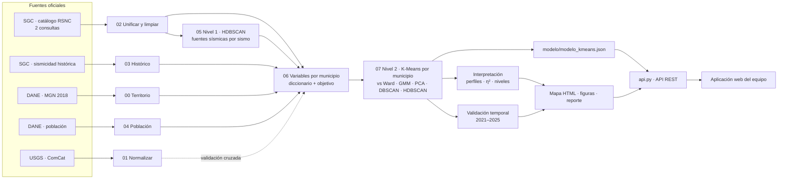

# Riesgo sísmico de Santander · Hackathon, categoría Medio

Prototipo de Machine Learning **no supervisado** que clasifica y compara el riesgo sísmico relativo de los
**87 municipios de Santander** con datos reales del catálogo sísmico del Servicio Geológico Colombiano (SGC), y
compara la zona del **Nido Sísmico de Bucaramanga** (área metropolitana + Los Santos) con el resto del departamento.
El resultado se sirve por una **API REST** y se ve en un **mapa interactivo**.

| Nivel | Modelo | Una fila = | Qué responde |
|---|---|---|---|
| 1 · Fuentes sísmicas | **HDBSCAN** | un sismo | ¿De dónde vienen los sismos? (Nido, fuentes intermedias, corticales, sismicidad difusa) |
| 2 · Clasificación territorial | **K-Means** | un municipio | ¿Qué municipios se parecen en su amenaza sísmica y en qué nivel quedan? |

---

## 1. Consumir la API (para el frontend)

**Arrancarla** (una vez instalada, deja la terminal abierta):

```bash
git clone -b claude/nifty-bohr-2a7cbu https://github.com/EDER1002/Modelo.git && cd Modelo
python -m venv .venv && source .venv/bin/activate      # Windows: .venv\Scripts\activate
pip install -r requirements-api.txt
python api.py                                          # -> http://localhost:8000
```

Abre **http://localhost:8000/docs**: ahí están todos los endpoints con un botón *Try it out* para probarlos.

**Los endpoints que vas a usar:**

| Para… | Llama a | Devuelve |
|---|---|---|
| Pintar el mapa | `GET /geojson` | Los 87 polígonos; cada uno trae `municipio`, `nivel`, `color`, `indice_riesgo` |
| Tabla / ranking | `GET /municipios` (filtros `?nivel=Muy alto`, `?zona_foco=true`) | Lista con `nivel`, `color`, `indice_riesgo`, `lat`, `lon` y variables clave |
| Ficha al hacer clic | `GET /municipios/{nombre o código DANE}` | Nivel, índice, variables, rasgos que lo distinguen, validación |
| Comparar municipios | `GET /comparar?municipios=Bucaramanga,Girón` | Variables lado a lado |
| Zona foco vs resto | `GET /zona-foco` | AMB + Los Santos frente al resto de Santander |
| Leyenda | `GET /niveles` | Niveles con su color y sus municipios |
| Sismos y fuentes | `GET /sismos?mag_min=4`, `GET /fuentes` | Epicentros M ≥ 3 y fuentes sísmicas de HDBSCAN |
| Métricas del modelo | `GET /modelo`, `GET /validacion` | k, silueta, estabilidad, validación temporal |

**Ejemplo (JavaScript + Leaflet):**

```js
const API = "http://localhost:8000";
const geo = await fetch(`${API}/geojson`).then(r => r.json());
L.geoJSON(geo, {
  style: f => ({ fillColor: f.properties.color, color: "#fff", weight: 1, fillOpacity: 0.8 }),
  onEachFeature: (f, capa) => capa.on("click", async () => {
    const ficha = await fetch(`${API}/municipios/${f.properties.cod_mpio}`).then(r => r.json());
    capa.bindPopup(`<b>${ficha.municipio}</b><br>Nivel: ${ficha.nivel}<br>Índice: ${ficha.indice_riesgo}`).openPopup();
  })
}).addTo(map);
```

Datos útiles: los niveles son `Muy bajo`, `Bajo`, `Medio`, `Alto`, `Muy alto` y cada respuesta trae su `color`
hex (usa ese mismo color en el frontend). Los nombres aceptan minúsculas y sin tildes (`giron` = `Girón`). La API
tiene CORS abierto. Contrato completo con ejemplos de respuesta: **[API.md](API.md)**.

---

## 2. Los dos modelos, explicados

### 2.1 Por qué dos niveles

Un municipio no "tiene" sismos: los recibe de **fuentes sísmicas** que pueden estar lejos o muy profundas. En
Santander la fuente dominante es el **Nido de Bucaramanga**, un volumen de ~10 km a ~140 km de profundidad bajo
Los Santos que produce cerca del 70 % de los sismos. Por eso el problema se parte en dos:

1. **Primero se entienden los sismos** (nivel 1): agrupar los ~31 000 sismos del periodo de entrenamiento para
   descubrir qué fuentes existen, sin decirle al algoritmo cuántas hay ni dónde están.
2. **Después se compara el territorio** (nivel 2): describir cada municipio con 21 variables (varias salen del
   nivel 1) y agrupar los 87 municipios en niveles de amenaza relativa.

```
 sismos (lat, lon, profundidad) ──► HDBSCAN ──► 10 fuentes + centro del Nido
                                                   │
 sismos + fuentes + municipios (DANE) ──► 21 variables por municipio ──► K-Means ──► 5 niveles ──► API / mapa
                                                                                         │
                                       sismos de un periodo POSTERIOR ──► validación ◄───┘
```

### 2.2 Modelo 1 · HDBSCAN: descubrir las fuentes sísmicas

**Entrada.** Una fila = un sismo bien localizado del periodo de entrenamiento (30 983 sismos, 2020-03 a 2023-02).
Solo tres variables, todas en kilómetros para que la distancia sea física: posición este–oeste (x), norte–sur (y)
y **profundidad**. No se usa magnitud ni calidad: una fuente es un *lugar* donde se concentran sismos.

**Cómo funciona.** HDBSCAN (*Hierarchical Density-Based Spatial Clustering of Applications with Noise*) busca
zonas donde los sismos están más apretados que a su alrededor:
1. Para cada sismo mide qué tan densa es su vecindad (distancia a su 10.º vecino más cercano).
2. Construye una jerarquía: a medida que se exige más densidad, las nubes de sismos se parten en sub-nubes.
3. Se queda con las nubes que **persisten** en un rango amplio de densidades (las más estables) y que tienen al
   menos 154 sismos (0.5 % del total).
4. Lo que no pertenece a ninguna nube estable queda como **sismicidad difusa (ruido)**, sin forzarlo a un grupo.

Así no hay que decirle cuántas fuentes buscar, las fuentes pueden tener cualquier forma (el Nido es compacto y las
fuentes del slab son alargadas) y no se mezclan sismos superficiales con profundos.

**Cómo se nombra cada fuente** (con su centro = mediana de sus sismos):
- **Nido de Bucaramanga**: centro a ≤ 40 km del Nido publicado (Prieto et al., 2012) y entre 110 y 190 km de profundidad.
- **Cortical**: profundidad mediana < 70 km (fallas de la corteza; son las más dañinas a igual magnitud).
- **Intermedia**: ≥ 70 km, fuera del Nido (la placa que se hunde bajo Santander).

**Resultado.** 10 fuentes y 20.5 % de sismicidad difusa. El Nido aparece solo, centrado en 6.788° N, 73.166° O,
141 km de profundidad: **a 7 km de la posición publicada**, sin haberle dado esa información al modelo.
Figura: `salidas/fig_fuentes_sismicas.png` (planta y perfil de profundidad) · tabla: `salidas/fuentes_sismicas.csv`.

**Comparación** (`salidas/comparacion_fuentes.csv`, misma muestra de evaluación):

| Método | Fuentes | Silueta ↑ | Davies-Bouldin ↓ | Sismicidad difusa |
|---|---:|---:|---:|---:|
| **HDBSCAN** | 10 | **0.588** | 0.586 | 20.5 % |
| K-Means (mismo k) | 10 | 0.339 | 0.904 | 0 % (obligado a asignar todo) |
| DBSCAN (eps por codo) | 18 | 0.471 | 0.485 | 4.3 % (fragmenta las fuentes) |

**Qué le entrega al nivel 2:** el centro del Nido (para distancias) y cinco variables por municipio: fracción de
sismos cercanos que vienen del Nido, de fuentes corticales y difusos, número de fuentes que lo afectan y distancia
a la fuente cortical más cercana.

### 2.3 Modelo 2 · K-Means: clasificar los 87 municipios

**Entrada.** Una fila = un municipio (87). Cada municipio se describe con **21 variables** calculadas con los
sismos del periodo de entrenamiento, casi todas en un círculo de 30 km alrededor del municipio (misma área para
todos, comparación justa):

| Familia | Variables | Qué mide |
|---|---|---|
| Actividad | `tasa_sismos_r30`, `tasa_m3_r30`, `tasa_fuertes_r30`, `densidad_epicentros` | Cuántos sismos por año (todos, sentidos M ≥ 3, fuertes M ≥ 4) |
| Magnitud | `mag_max_r30`, `mag_p95_r30`, `valor_b_r30` | Qué tan grandes son (b bajo = más proporción de sismos grandes) |
| Energía | `log_energia_anual_r30`, `log_flujo_energia_hipo` | Energía liberada cerca y energía que **llega** al municipio con distancia hipocentral |
| Profundidad | `prof_mediana_r30`, `frac_superficiales_r30`, `tasa_superficiales_r30`, `mag_max_superficial_r30` | Si los sismos son profundos (Nido) o superficiales (más dañinos) |
| Distancia | `dist_nido_km`, `dist_sismo_fuerte_km`, `dist_sismo_superficial_m3_km` | Cercanía a las fuentes de peligro |
| Fuentes (del nivel 1) | `frac_nido_r30`, `frac_cortical_r30`, `frac_difusa_r30`, `n_fuentes_r30`, `dist_fuente_cortical_km` | Qué tipo de fuente domina su entorno |

Definición, unidad, fuente y justificación de cada una: `docs/diccionario_datos.md`.

**Preparación.** Solo sismos bien localizados y con M ≥ Mc = 2.0 (magnitud de completitud, para que "mejor red de
estaciones" no parezca "más sismos"); `log(1 + x)` en las variables muy sesgadas (conteos y distancias) y
estandarización z para que todas pesen igual.

**Cómo funciona K-Means.** Busca k "municipios típicos" (centroides) en el espacio de las 21 variables y asigna
cada municipio al centroide más parecido (distancia euclidiana). Repite *asignar → recalcular centroides* hasta que
nada cambia, y lo intenta desde 200 puntos de partida para quedarse con la mejor solución. Cada centroide es un
**perfil interpretable** ("mucha actividad profunda cerca del Nido", "sismicidad cortical moderada", etc.).

**Cómo se eligió.** Se compararon 6 métodos (K-Means, Ward, mezcla gaussiana, PCA + K-Means, DBSCAN y HDBSCAN) con
silueta, Davies-Bouldin, Calinski-Harabasz y **estabilidad bootstrap** (se re-entrena con 30 remuestreos y se mide
cuánto se conserva la agrupación, ARI). Regla: K-Means, k entre 3 y 5 (interpretable), todos los grupos con ≥ 3
municipios, mejor silueta → **k = 5** (silueta 0.318, estabilidad ARI 0.78). K-Means queda por encima de la mezcla
gaussiana y empata con Ward y PCA + K-Means; DBSCAN y HDBSCAN logran silueta parecida o mayor solo dejando entre
16 % y 37 % de los municipios **sin clasificar**, lo que no sirve para un mapa de riesgo. Detalle:
`salidas/comparacion_modelos.csv` y `salidas/fig_seleccion_modelos.png`.

**De grupos a niveles.** K-Means forma los grupos pero no dice cuál es "más peligroso". Un índice (0–100) los
ordena: promedio de componentes estandarizados **+ actividad + magnitud + energía + sacudida en el sitio +
superficialidad − distancia a las fuentes**. El grupo con mayor índice medio es *Muy alto* y así hacia abajo.
El índice **solo nombra** los grupos; no los forma. Si el índice de un municipio cae a 2 o más niveles de su grupo
(p. ej. Bucaramanga), el reporte lo marca como **perfil mixto** en vez de moverlo a mano.

**Validación sin fuga de información.** La variable objetivo (`obj_tasa_fuertes_futura_r50`: sismos M ≥ 4 por año a
≤ 50 km) se calcula con un periodo **posterior** (2023-03 a 2025-03) que el modelo nunca vio:

| Nivel | Municipios | M ≥ 4 por año después (media) |
|---|---:|---:|
| Muy alto | 19 | 34.6 |
| Alto | 7 | 33.9 |
| Medio | 25 | 6.3 |
| Bajo | 27 | 3.3 |
| Muy bajo | 9 | 1.3 |

La actividad futura **crece con cada nivel** (Spearman 0.70, p < 10⁻¹³; Kruskal-Wallis p = 5 × 10⁻¹¹), mejor que la
referencia ingenua "la tasa pasada predice la futura" (0.69): los niveles **anticipan** dónde siguió la actividad fuerte.

**Resultado territorial.** *Muy alto*: los municipios sobre el Nido (Los Santos, Zapatoca, Villanueva, Jordán,
Barichara, San Gil, Piedecuesta, Girón, Floridablanca…). La zona foco tiene 4 de sus 5 municipios en *Muy alto*;
Bucaramanga queda en *Bajo* por su perfil a ≤ 30 km pero su índice (57) y la energía que le llega son casi los de
Los Santos: es el principal **perfil mixto** y se explica en `salidas/reporte_modelo.md` §5.

**Qué guarda el modelo.** `modelo/modelo_kmeans.json`: las 21 variables, su transformación, la media y escala de
la estandarización y los 5 centroides. Clasificar un municipio = transformar → estandarizar → centroide más
cercano. Es lo que usan la API (`POST /clasificar`) y `usar_modelo.py`; no depende de la versión de scikit-learn.

**Límites.** Es riesgo **relativo** entre municipios: sin datos de vulnerabilidad (tipo de construcción) no estima
pérdidas. Sin población DANE el resultado es amenaza sin exposición. Los Excel actuales cubren 2020-03 a 2025-03
y se pidieron por departamento (ver §3.6).

---

## 3. Uso completo del proyecto

### 3.1 Ver los resultados sin instalar nada

| Abre | Qué es |
|---|---|
| `salidas/mapa_riesgo_santander.html` | Mapa interactivo (doble clic; pasa el cursor sobre un municipio) |
| `salidas/reporte_modelo.md` | Reporte completo: datos, modelos comparados, niveles, validación, zona foco, los 87 municipios |
| `salidas/municipios_clasificados.csv` | Nivel, índice y variables de cada municipio (Excel lo abre) |
| `salidas/fig_*.png` | Figuras para la presentación |
| `docs/diccionario_datos.md` | Qué significa cada variable |

### 3.2 Instalar todo (para re-entrenar)
Python 3.10 o más nuevo, en un **entorno virtual** (en Arch, Ubuntu 23+ o Debian 12+ el `pip install` global da
`externally-managed-environment`):

```bash
python -m venv .venv && source .venv/bin/activate     # fish: activate.fish · Windows: .venv\Scripts\activate
pip install -r requirements.txt
```

### 3.3 Re-entrenar
```bash
python run_all.py            # ~1–2 min: catálogo, fuentes, variables, modelo, mapa, reporte y modelo JSON
python run_all.py --usgs     # + validación cruzada con USGS (necesita internet)
python tests/probar_api.py   # comprueba que la API responde bien
```
Para sumar datos, mete más exports del SGC (Excel o CSV, formato antiguo o nuevo, cualquier nombre) en
`datos/raw/sgc/` y vuelve a correr `run_all.py`. Los periodos de variables/objetivo se ajustan solos a las fechas
de los archivos; luego reinicia la API.

### 3.4 Consultar el modelo sin servidor
```bash
python usar_modelo.py Bucaramanga        # ficha · también: 68001, --lista, --nivel "Muy alto", --resumen, --json
python usar_modelo.py --clasificar nuevos.csv
```
```python
from usar_modelo import ModeloSismico
ModeloSismico().consultar("Floridablanca")["nivel"]
```

### 3.5 API con Docker
```bash
docker build -t sismos-api . && docker run -p 8000:8000 sismos-api
```

### 3.6 Estado actual de los datos
- **Incluido:** catálogo SGC 2020-03-02 a 2025-03-01 (5 exports, 64 027 sismos) y límites DANE MGN 2018.
- **Periodos usados:** variables 2020-03-02 a 2023-02-28, objetivo 2023-03-01 a 2025-03-01 (con los exports
  2006–2025 el pipeline vuelve solo a 2006–2020 / 2021–2025).
- **Falta:** exports del SGC con el **formato antiguo** (antes de 2018-03), sismicidad histórica (`datos/raw/sgc_historico/`),
  USGS (`datos/raw/usgs/`) y población DANE (`datos/raw/dane/`). El código ya los lee; basta con poner los archivos.
- Los exports actuales se pidieron **por departamento**; para los municipios de borde conviene la consulta por
  cuadrante (§5.1).

---

## 4. ¿Qué zona de estudio? (Bucaramanga, Santander o Colombia)

**Santander completo, con el municipio como unidad territorial (87 unidades), y el Área Metropolitana de Bucaramanga + Los Santos como zona foco.**

| Opción | ¿Sirve? | Por qué |
|---|---|---|
| Solo Bucaramanga | ✗ | La categoría Medio exige *comparar con otras unidades territoriales mediante grupos*. Con una sola unidad no hay nada que agrupar. Además, la mayoría de los epicentros del Nido no caen en Bucaramanga, sino en Los Santos, Cepitá, Aratoca, Jordán, Zapatoca y Betulia. |
| **Santander (87 municipios)** | ✓ | Es lo que pide el reto ("una zona de Santander"). Hay variedad real para agrupar: el Nido (sismos intermedios a unos 150 km de profundidad), la Falla de Bucaramanga (sismos superficiales), el Magdalena Medio (poca actividad) y la provincia de García Rovira. |
| Toda Colombia | ✗ | Se sale del enfoque del reto y diluye la interpretación territorial que evalúa el jurado. Solo se usa un **margen de unos 50 km** alrededor de Santander para que los municipios de borde también "vean" los sismos cercanos. |

Periodo: **2006-01-01 a 2025-12-31** (20 años completos, el tema de referencia). Las variables se calculan con 2006–2020 y la variable objetivo con 2021–2025 (ver §9). Si los exports no cubren esos años, el pipeline parte el rango disponible (60 % variables / 40 % objetivo, sin solaparse); hoy, con 2020-03 a 2025-03, usa variables 2020-03-02 a 2023-02-28 y objetivo 2023-03-01 a 2025-03-01.

---

## 5. Qué trae el paquete y qué falta descargar

| Dato | Estado | Dónde |
|---|---|---|
| Límites municipales DANE MGN 2018 (87 municipios, área oficial) | ✅ incluido | `datos/raw/dane/` |
| Sismicidad histórica SGC (sismos con daño, intensidad EMS-98) | ⬇️ descargar (opcional; hoy no está) | `datos/raw/sgc_historico/` |
| **Catálogo sísmico SGC – RSNC** (fuente principal) | ✅ 2020-03 a 2025-03 incluido · ⬇️ 2006–2020 para el periodo completo | `datos/raw/sgc/` |
| Catálogo USGS (validación cruzada) | ⬇️ descargar (opcional, recomendado) | `datos/raw/usgs/` |
| Población municipal DANE (exposición) | ⬇️ descargar (opcional, recomendado) | `datos/raw/dane/` |

### 5.1 Catálogo SGC (obligatorio)
Portal: <http://bdrsnc.sgc.gov.co/paginas1/catalogo/>. Tiene **dos consultas con columnas distintas**: junio 1993 a febrero 2018, y desde marzo 2018. Usa las dos y exporta **año por año** (o mes por mes en los años con muchos eventos):

- Fecha: 2006-01-01 a 2025-12-31 (en la consulta antigua hasta 2018-02-28; en la nueva desde 2018-03-01)
- Latitud: **5.2 a 8.7** · Longitud: **−75.0 a −72.0**
- Magnitud y profundidad: **sin filtro** (todo el rango)
- Formato: CSV o Excel, el que ofrezca. El script reconoce las columnas por su nombre.
- Guarda todos los archivos en `datos/raw/sgc/`. El nombre no importa.
- **Anota la fecha de descarga** y ponla en `config.py` → `FECHA_DESCARGA_SGC`.

### 5.2 USGS (opcional)
Abre este enlace y guarda el CSV en `datos/raw/usgs/`:
<https://earthquake.usgs.gov/fdsnws/event/1/query?format=csv&starttime=2006-01-01&endtime=2026-01-01&minlatitude=5.2&maxlatitude=8.7&minlongitude=-75.0&maxlongitude=-72.0&orderby=time-asc>.
Otra opción es correr `python scripts/01_descargar_usgs.py`, que lo descarga solo.

### 5.3 Población DANE (opcional)
En <https://www.dane.gov.co/index.php/estadisticas-por-tema/demografia-y-poblacion/proyecciones-de-poblacion> descarga el Excel de **proyecciones de población municipal por área** y ponlo en `datos/raw/dane/`. Si el formato no se reconoce, crea `datos/raw/dane/poblacion_manual.csv` con las columnas `cod_mpio,poblacion,poblacion_cabecera`.

### 5.4 MGN oficial (opcional)
El GeoJSON incluido es el MGN 2018 del DANE simplificado. Para la versión exacta, baja `MGN2018_MPIO_POLITICO` del [Geoportal DANE](https://geoportal.dane.gov.co/servicios/descarga-y-metadatos/descarga-mgn-marco-geoestadistico-nacional/), descomprímelo y pon el `.shp` (con sus `.dbf`, `.shx` y `.prj`) en `datos/raw/dane/`. El paso 00 lo usa automáticamente.

---

## 6. Cómo correrlo

```bash
python -m venv .venv && source .venv/bin/activate
pip install -r requirements.txt
python run_all.py            # pipeline completo (~1–2 min)
python run_all.py --usgs     # + validación cruzada con USGS (necesita internet)
python usar_modelo.py --resumen   # consultar el modelo entrenado (ver §3.4)
```

Cada paso también se puede correr suelto: `python scripts/06_construir_variables.py`.

Para probar el pipeline antes de tener el SGC, existe `python run_all.py --solo-usgs`. **No sirve para la entrega**, porque la fuente principal exigida es el SGC.

---

## 7. Qué produce

| Archivo | Para qué |
|---|---|
| `datos/processed/dataset_municipios.csv` | **La tabla del modelo**: 87 filas (municipios) × variables |
| `modelo/modelo_kmeans.json` | **El modelo entrenado** (escalador + centroides K-Means, portable) que usan `api.py` y `usar_modelo.py` |
| `api.py` + `API.md` | **API REST** del modelo (FastAPI) y su contrato con ejemplos |
| `salidas/municipios_niveles.geojson`, `salidas/sismos_relevantes.csv` | Archivos livianos que sirve la API (polígonos con nivel y sismos M ≥ 3) |
| `salidas/municipios_clasificados.csv` | Nivel, índice y variables de cada municipio |
| `datos/processed/catalogo_con_municipio.csv` | Catálogo SGC unificado y limpio, un sismo por fila, con su municipio y su fuente (no se sube a git por tamaño; `run_all.py` lo genera) |
| `docs/diccionario_datos.md` / `.csv` | Nombre, tipo, unidad, fuente y justificación de cada variable |
| `docs/metadatos_origen.md` | Fuente, URL, fecha de descarga y filtros de cada dataset |
| `datos/interim/reporte_limpieza_sgc.md` | Bitácora de limpieza: duplicados, faltantes, atípicos, unidades |
| `datos/interim/reporte_variables.md` | Mc, centro del Nido, imputaciones, validación cruzada con USGS |
| `salidas/mapa_riesgo_santander.html` | **Prototipo**: mapa interactivo por municipio (abrir en el navegador) |
| `salidas/reporte_modelo.md` | Comparación de modelos, grupos, importancia de variables, validación y zona foco |
| `salidas/fuentes_sismicas.csv`, `comparacion_fuentes.csv` | Nivel 1: fuentes encontradas por HDBSCAN y su comparación con K-Means y DBSCAN |
| `salidas/fig_*.png` | Figuras para la presentación (incluye `fig_fuentes_sismicas.png`: planta y perfil de profundidad) |

---

## 8. Arquitectura



---

## 9. Decisiones de modelado (para defender ante el jurado)

- **¿Por qué dos niveles y no un solo modelo?** Con sismos individuales K-Means rinde peor: el Nido tiene ~70 % de los eventos, K-Means necesita que le digas cuántos grupos hay y obliga a meter la sismicidad difusa en algún grupo. HDBSCAN agrupa por densidad, encuentra solo el número de fuentes y deja aparte la sismicidad difusa. Con el catálogo 2020–2023 encontró 10 fuentes y el Nido a 7 km de la posición publicada (silueta 0.59 vs 0.34 de K-Means con el mismo k; `salidas/comparacion_fuentes.csv`). Pero la categoría Medio pide clasificar *municipios*, y ahí cada municipio necesita un nivel: HDBSCAN deja entre 16 % y 37 % de los municipios sin grupo (100 % con `min_cluster_size=8`), mientras K-Means clasifica todos con buena estabilidad. Por eso: HDBSCAN para encontrar las fuentes, K-Means para clasificar el territorio.
- **Unidad = municipio, con vecindario de 30 km.** Un municipio sufre los sismos de su entorno, no solo los que tienen epicentro dentro. Por eso la mayoría de variables se calculan en un círculo de 30 km alrededor del punto representativo de cada municipio, que tiene la misma área para todos y así la comparación es justa. La densidad de epicentros propios sí usa el polígono oficial.
- **Magnitud de completitud (Mc).** La red del SGC mejoró con los años y hoy detecta sismos más pequeños. Para no confundir "mejor red" con "más sismos", los conteos usan solo M ≥ Mc, con Mc estimado por máxima curvatura + 0.2 y tomando el peor año (Mc homogéneo).
- **Calidad de localización.** Fases, RMS, Gap y los errores de latitud, longitud y profundidad **no entran al modelo**. Describen la cobertura de la red de estaciones, no la amenaza. Con el catálogo 2024, un K-Means con todas las columnas agrupa sobre todo por error de longitud, RMS y error de profundidad, y no por ubicación. Por eso se usan como **filtro**: se excluyen los sismos con gap > 270°, RMS > 1.2 s, error horizontal o de profundidad > 10 km, o menos de 6 fases (12 % en 2020–2025). **El RMS no se aplica a M ≥ 3**: los sismos grandes los registran estaciones lejanas y su RMS sube aunque estén bien localizados; sin esa excepción se perdía el 33 % de los M ≥ 4 (con error de profundidad mediano de 4 km), justo los que más importan.
- **Distancia hipocentral (Nido).** Un sismo del Nido ocurre a ~140 km de profundidad: está casi igual de lejos de Bucaramanga (147 km) que de Los Santos (141 km), aunque su epicentro no caiga a ≤ 30 km de Bucaramanga. Por eso, además de las variables a ≤ 30 km, se usa `log_flujo_energia_hipo` = Σ E / (4π R²) con R hipocentral y todos los sismos. Con ella la correlación nivel vs. sismos M ≥ 4 futuros pasó de 0.51 a 0.70.
- **Magnitud homogénea.** Se usa Mw cuando existe y, si no, la magnitud reportada (ML). El tipo queda registrado en cada evento.
- **Sismicidad histórica.** El catálogo instrumental empieza en 1993. Los sismos históricos con daño (por ejemplo Betulia 1967, Los Santos 2015 o Cúcuta 1875) aportan la intensidad real observada.
- **Variable objetivo sin fuga de información.** `obj_tasa_fuertes_futura_r50` es la tasa de sismos M ≥ 4 a ≤ 50 km en **2021–2025**. Las variables usan **2006–2020**. Son observaciones distintas, así que el objetivo no se calcula a partir de las entradas. No se usa para entrenar: solo valida e interpreta los grupos ("¿los grupos de mayor amenaza tuvieron más sismos fuertes después?"). Esto además le da al modelo **capacidad de anticipar**.
- **Comparación de enfoques.** Se evalúan K-Means, Ward, mezcla gaussiana y PCA + K-Means con k = 2…8, más DBSCAN y HDBSCAN, usando silueta, Davies–Bouldin y Calinski–Harabasz. Se elige la mejor silueta de K-Means con k entre 3 y 5 (interpretable; con 6 tonos de un mismo color dos niveles vecinos no se distinguen en el mapa) y grupos de al menos 3 municipios. La estabilidad se mide con bootstrap (ARI).
- **De grupos a riesgo.** Después del clustering, los grupos se ordenan con un índice que suma actividad, magnitud, energía, sacudida en el sitio (flujo hipocentral), superficialidad, historia y exposición, y resta la distancia a las fuentes. El modelo forma los grupos y el índice solo los nombra (Muy bajo → Muy alto). Los municipios cuyo índice cae a 2+ niveles de su grupo (p. ej. Bucaramanga) se reportan como **perfil mixto** en el reporte, sin reasignarlos a mano.
- **Amenaza vs riesgo.** Riesgo = amenaza × exposición × vulnerabilidad. Con población medimos amenaza + exposición. La vulnerabilidad (tipo de construcción) no está en estas fuentes, así que el resultado es **riesgo relativo**, no pérdidas absolutas. Conviene decirlo en la presentación.

---

## 10. Cómo cubre la rúbrica (100 pts)

| Criterio | Pts | Evidencia |
|---|---:|---|
| Datos y preprocesamiento | 15 | ≥15 variables justificadas (21 de modelo sin población ni histórico; hasta 27 con ellos), más territoriales descriptivas → `docs/diccionario_datos.md`; limpieza → `reporte_limpieza_sgc.md`; origen → `docs/metadatos_origen.md` |
| Modelo no supervisado | 25 | Dos niveles: HDBSCAN vs K-Means vs DBSCAN por sismo (`comparacion_fuentes.csv`, `fig_fuentes_sismicas.png`) y 6 enfoques por municipio (`comparacion_modelos.csv`, `fig_seleccion_modelos.png`); estabilidad, perfiles (`fig_perfiles_grupos.png`), importancia η² (`fig_importancia_variables.png`) |
| Arquitectura | 15 | Diagrama §8 + scripts numerados (datos → procesamiento → modelo → visualización) |
| Prototipo y visualización territorial | 10 | `mapa_riesgo_santander.html` + `run_all.py` lo regenera desde cero + API REST (`api.py`, `API.md`) que consume la aplicación |
| Impacto e innovación | 15 | Niveles de amenaza/riesgo, validación temporal (anticipa), memoria histórica, exposición, zona foco vs resto |
| Presentación | 20 | `reporte_modelo.md` sirve de guion: problema → datos → modelo → grupos → validación → mapa |

---

## 11. Fuentes de datos (APIs) y librerías

| Fuente | Cómo se obtiene | Script |
|---|---|---|
| **USGS ComCat** | API pública FDSN (`earthquake.usgs.gov/fdsnws/event/1/query`), descarga automática año por año | `01_descargar_usgs.py` |
| **SGC – catálogo RSNC** | Exportación desde el portal (`bdrsnc.sgc.gov.co/paginas1/catalogo/`). El SGC no ofrece una API pública documentada: su web usa una API interna que bloquea el acceso externo, así que la vía oficial es el portal, que además deja constancia de fecha y filtros como pide la rúbrica | `02_unificar_sgc.py` |
| **SGC – sismicidad histórica** | Exportación del visor SISH (opcional; hoy no está en el repositorio) | `03_sismicidad_historica.py` |
| **DANE – MGN 2018** | Geoportal DANE (incluido) | `00_preparar_territorio.py` |
| **DANE – población** | Excel de proyecciones municipales | `04_poblacion_dane.py` |
| **API del modelo (este proyecto)** | REST/JSON con FastAPI: `python api.py`, documentación en `/docs` | `api.py` |

Librerías: `fastapi` y `uvicorn` (API), `pandas` y `numpy` (datos), `geopandas`, `shapely` y `pyproj` (municipios y distancias), `scikit-learn` (HDBSCAN, K-Means, Ward, mezcla gaussiana, DBSCAN, PCA, métricas), `scipy` (estadística), `matplotlib` (figuras), `folium` (mapa), `requests` (API USGS), `xlrd`, `openpyxl` y `python-calamine` (Excel del SGC y DANE).

## 12. Si algo falla

- **`error: externally-managed-environment`** al hacer `pip install`: tu sistema (Arch, Ubuntu 23+, Debian 12+) no deja instalar paquetes globales. Usa el entorno virtual de §3.2.
- **`can't open file .../scripts/00_preparar_territorio.py`**: estás en una carpeta sin `scripts/`. Entra a la carpeta del proyecto (la que tiene `run_all.py` y `scripts/`).
- **El Excel del SGC no abre** (error de estilos): se lee con `python-calamine`, que ya está en `requirements.txt`.
- **"No reconozco columnas clave"** en el paso 02: el error lista las columnas que encontró. Agrega la palabra que falte en `mapear_columnas()` dentro de `scripts/02_unificar_sgc.py`.
- **"SUPUESTA UTC, verificar"** en el reporte de limpieza: la exportación no decía si la hora es UTC o local. El catálogo del SGC normalmente usa UTC. Si era local, el script la convierte cuando la columna dice "local".
- **Muy pocos eventos**: revisa que exportaste todos los años y que no quedó un filtro de magnitud puesto.
- Los parámetros (radios, periodos, umbrales, zona foco) están en `config.py`. Cambia el valor y corre `python run_all.py` otra vez.

## Referencias

- Servicio Geológico Colombiano, Red Sismológica Nacional de Colombia: catálogo sísmico y sismicidad histórica.
- DANE: Marco Geoestadístico Nacional 2018 y proyecciones de población municipal.
- Prieto, G. A., Beroza, G. C., Barrett, S. A., López, G. A. y Florez, M. (2012). Earthquake nests as natural laboratories for the study of intermediate-depth earthquake mechanics. *Tectonophysics*, 570–571, 42–56.
- Wiemer, S. y Wyss, M. (2000). Minimum magnitude of completeness in earthquake catalogs. *BSSA*.
- Aki, K. (1965). Maximum likelihood estimate of b in the formula log N = a − bM. *Bull. Earthq. Res. Inst.*
