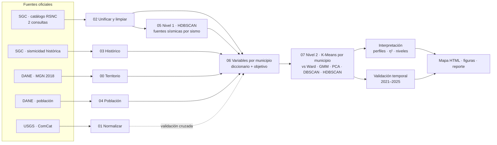

# Riesgo sísmico de Santander · Hackathon, categoría Medio

Agrupamos los **87 municipios de Santander** según su comportamiento sísmico en los últimos 20 años, usando datos reales del Servicio Geológico Colombiano (SGC), y comparamos la zona del **Nido Sísmico de Bucaramanga** (área metropolitana + Mesa de Los Santos) con el resto del departamento.

**Modelo no supervisado en dos niveles:**

| Nivel | Modelo | Una fila = | Para qué |
|---|---|---|---|
| 1 · Fuentes sísmicas | **HDBSCAN** (comparado con K-Means y DBSCAN) | un sismo | Descubrir las fuentes (Nido, sismicidad intermedia, cortical) usando solo latitud, longitud y profundidad en km |
| 2 · Clasificación territorial | **K-Means** (comparado con Ward, mezcla gaussiana, PCA, DBSCAN y HDBSCAN) | un municipio | Agrupar y comparar los 87 municipios con ≥ 15 variables, incluidas las que salen del nivel 1 |

Los grupos se traducen en **niveles de amenaza/riesgo relativo**, se validan contra la actividad de un periodo posterior y se muestran en un **mapa interactivo reproducible**.

---

## 1. ¿Qué zona de estudio? (Bucaramanga, Santander o Colombia)

**Santander completo, con el municipio como unidad territorial (87 unidades), y el Área Metropolitana de Bucaramanga + Los Santos como zona foco.**

| Opción | ¿Sirve? | Por qué |
|---|---|---|
| Solo Bucaramanga | ✗ | La categoría Medio exige *comparar con otras unidades territoriales mediante grupos*. Con una sola unidad no hay nada que agrupar. Además, la mayoría de los epicentros del Nido no caen en Bucaramanga, sino en Los Santos, Cepitá, Aratoca, Jordán, Zapatoca y Betulia. |
| **Santander (87 municipios)** | ✓ | Es lo que pide el reto ("una zona de Santander"). Hay variedad real para agrupar: el Nido (sismos intermedios a unos 150 km de profundidad), la Falla de Bucaramanga (sismos superficiales), el Magdalena Medio (poca actividad) y la provincia de García Rovira. |
| Toda Colombia | ✗ | Se sale del enfoque del reto y diluye la interpretación territorial que evalúa el jurado. Solo se usa un **margen de unos 50 km** alrededor de Santander para que los municipios de borde también "vean" los sismos cercanos. |

Periodo: **2006-01-01 a 2025-12-31** (20 años completos, el tema de referencia). Las variables se calculan con 2006–2020 y la variable objetivo con 2021–2025 (ver §6).

---

## 2. Qué trae el paquete y qué falta descargar

| Dato | Estado | Dónde |
|---|---|---|
| Límites municipales DANE MGN 2018 (87 municipios, área oficial) | ✅ incluido | `datos/raw/dane/` |
| Sismicidad histórica SGC (84 sismos con daño, 1644–2023, intensidad EMS-98) | ✅ incluido y procesado | `datos/raw/sgc_historico/` |
| **Catálogo sísmico SGC – RSNC** (fuente principal) | ⬇️ **descargar** | `datos/raw/sgc/` |
| Catálogo USGS (validación cruzada) | ⬇️ descargar (opcional, recomendado) | `datos/raw/usgs/` |
| Población municipal DANE (exposición) | ⬇️ descargar (opcional, recomendado) | `datos/raw/dane/` |

### 2.1 Catálogo SGC (obligatorio)
Portal: <http://bdrsnc.sgc.gov.co/paginas1/catalogo/>. Tiene **dos consultas con columnas distintas**: junio 1993 a febrero 2018, y desde marzo 2018. Usa las dos y exporta **año por año** (o mes por mes en los años con muchos eventos):

- Fecha: 2006-01-01 a 2025-12-31 (en la consulta antigua hasta 2018-02-28; en la nueva desde 2018-03-01)
- Latitud: **5.2 a 8.7** · Longitud: **−75.0 a −72.0**
- Magnitud y profundidad: **sin filtro** (todo el rango)
- Formato: CSV o Excel, el que ofrezca. El script reconoce las columnas por su nombre.
- Guarda todos los archivos en `datos/raw/sgc/`. El nombre no importa.
- **Anota la fecha de descarga** y ponla en `config.py` → `FECHA_DESCARGA_SGC`.

### 2.2 USGS (opcional)
Abre este enlace y guarda el CSV en `datos/raw/usgs/`:
<https://earthquake.usgs.gov/fdsnws/event/1/query?format=csv&starttime=2006-01-01&endtime=2026-01-01&minlatitude=5.2&maxlatitude=8.7&minlongitude=-75.0&maxlongitude=-72.0&orderby=time-asc>.
Otra opción es correr `python scripts/01_descargar_usgs.py`, que lo descarga solo.

### 2.3 Población DANE (opcional)
En <https://www.dane.gov.co/index.php/estadisticas-por-tema/demografia-y-poblacion/proyecciones-de-poblacion> descarga el Excel de **proyecciones de población municipal por área** y ponlo en `datos/raw/dane/`. Si el formato no se reconoce, crea `datos/raw/dane/poblacion_manual.csv` con las columnas `cod_mpio,poblacion,poblacion_cabecera`.

### 2.4 MGN oficial (opcional)
El GeoJSON incluido es el MGN 2018 del DANE simplificado. Para la versión exacta, baja `MGN2018_MPIO_POLITICO` del [Geoportal DANE](https://geoportal.dane.gov.co/servicios/descarga-y-metadatos/descarga-mgn-marco-geoestadistico-nacional/), descomprímelo y pon el `.shp` (con sus `.dbf`, `.shx` y `.prj`) en `datos/raw/dane/`. El paso 00 lo usa automáticamente.

---

## 3. Cómo correrlo

```bash
python -m venv .venv && source .venv/bin/activate
pip install -r requirements.txt
python run_all.py            # pipeline completo
python run_all.py --usgs     # + validación cruzada con USGS
```

Cada paso también se puede correr suelto: `python scripts/06_construir_variables.py`.

Para probar el pipeline antes de tener el SGC, existe `python run_all.py --solo-usgs`. **No sirve para la entrega**, porque la fuente principal exigida es el SGC.

---

## 4. Qué produce

| Archivo | Para qué |
|---|---|
| `datos/processed/dataset_municipios.csv` | **La tabla del modelo**: 87 filas (municipios) × variables |
| `datos/processed/catalogo_con_municipio.csv` | Catálogo SGC unificado y limpio, un sismo por fila, con su municipio |
| `docs/diccionario_datos.md` / `.csv` | Nombre, tipo, unidad, fuente y justificación de cada variable |
| `docs/metadatos_origen.md` | Fuente, URL, fecha de descarga y filtros de cada dataset |
| `datos/interim/reporte_limpieza_sgc.md` | Bitácora de limpieza: duplicados, faltantes, atípicos, unidades |
| `datos/interim/reporte_variables.md` | Mc, centro del Nido, imputaciones, validación cruzada con USGS |
| `salidas/mapa_riesgo_santander.html` | **Prototipo**: mapa interactivo por municipio (abrir en el navegador) |
| `salidas/reporte_modelo.md` | Comparación de modelos, grupos, importancia de variables, validación y zona foco |
| `salidas/fuentes_sismicas.csv`, `comparacion_fuentes.csv` | Nivel 1: fuentes encontradas por HDBSCAN y su comparación con K-Means y DBSCAN |
| `salidas/fig_*.png` | Figuras para la presentación (incluye `fig_fuentes_sismicas.png`: planta y perfil de profundidad) |

---

## 5. Arquitectura



---

## 6. Decisiones de modelado (para defender ante el jurado)

- **¿Por qué dos niveles y no un solo modelo?** Con sismos individuales, K-Means falla: el Nido tiene ~70 % de los eventos y K-Means solo separa "Nido contra el resto", revolviendo sismos superficiales con profundos. HDBSCAN agrupa por densidad, no necesita que le digas cuántos grupos hay y deja aparte la sismicidad difusa. Con el catálogo 2024 encontró 8 fuentes (silueta 0.57 vs 0.30 de K-Means). Pero la categoría Medio pide clasificar *municipios*, y ahí cada municipio necesita un nivel: HDBSCAN deja ~40 % de los municipios sin grupo, mientras K-Means clasifica todos con buena silueta y estabilidad. Por eso: HDBSCAN para encontrar las fuentes, K-Means para clasificar el territorio.
- **Unidad = municipio, con vecindario de 30 km.** Un municipio sufre los sismos de su entorno, no solo los que tienen epicentro dentro. Por eso la mayoría de variables se calculan en un círculo de 30 km alrededor del punto representativo de cada municipio, que tiene la misma área para todos y así la comparación es justa. La densidad de epicentros propios sí usa el polígono oficial.
- **Magnitud de completitud (Mc).** La red del SGC mejoró con los años y hoy detecta sismos más pequeños. Para no confundir "mejor red" con "más sismos", los conteos usan solo M ≥ Mc, con Mc estimado por máxima curvatura + 0.2 y tomando el peor año (Mc homogéneo).
- **Calidad de localización.** Fases, RMS, Gap y los errores de latitud, longitud y profundidad **no entran al modelo**. Describen la cobertura de la red de estaciones, no la amenaza. Con el catálogo 2024, un K-Means con todas las columnas agrupa sobre todo por error de longitud, RMS y error de profundidad, y no por ubicación. Por eso se usan como **filtro**: se excluyen los sismos con gap > 270°, RMS > 1.2 s, error horizontal o de profundidad > 10 km, o menos de 6 fases (≈ 10 % en 2024).
- **Magnitud homogénea.** Se usa Mw cuando existe y, si no, la magnitud reportada (ML). El tipo queda registrado en cada evento.
- **Sismicidad histórica.** El catálogo instrumental empieza en 1993. Los sismos históricos con daño (por ejemplo Betulia 1967, Los Santos 2015 o Cúcuta 1875) aportan la intensidad real observada.
- **Variable objetivo sin fuga de información.** `obj_tasa_fuertes_futura_r50` es la tasa de sismos M ≥ 4 a ≤ 50 km en **2021–2025**. Las variables usan **2006–2020**. Son observaciones distintas, así que el objetivo no se calcula a partir de las entradas. No se usa para entrenar: solo valida e interpreta los grupos ("¿los grupos de mayor amenaza tuvieron más sismos fuertes después?"). Esto además le da al modelo **capacidad de anticipar**.
- **Comparación de enfoques.** Se evalúan cinco métodos con k = 2…8 usando silueta, Davies–Bouldin y Calinski–Harabasz. Se elige la mejor silueta con k entre 3 y 6 (interpretable) y grupos de al menos 3 municipios. La estabilidad se mide con bootstrap (ARI).
- **De grupos a riesgo.** Después del clustering, los grupos se ordenan con un índice que suma actividad, magnitud, energía, superficialidad, historia y exposición, y resta la distancia a las fuentes. El modelo forma los grupos y el índice solo los nombra (Bajo → Muy alto).
- **Amenaza vs riesgo.** Riesgo = amenaza × exposición × vulnerabilidad. Con población medimos amenaza + exposición. La vulnerabilidad (tipo de construcción) no está en estas fuentes, así que el resultado es **riesgo relativo**, no pérdidas absolutas. Conviene decirlo en la presentación.

---

## 7. Cómo cubre la rúbrica (100 pts)

| Criterio | Pts | Evidencia |
|---|---:|---|
| Datos y preprocesamiento | 15 | ≥15 variables justificadas (22 sin población, 25 con ella), incluidas territoriales → `docs/diccionario_datos.md`; limpieza → `reporte_limpieza_sgc.md`; origen → `docs/metadatos_origen.md` |
| Modelo no supervisado | 25 | Dos niveles: HDBSCAN vs K-Means vs DBSCAN por sismo (`comparacion_fuentes.csv`, `fig_fuentes_sismicas.png`) y 6 enfoques por municipio (`comparacion_modelos.csv`, `fig_seleccion_modelos.png`); estabilidad, perfiles (`fig_perfiles_grupos.png`), importancia η² (`fig_importancia_variables.png`) |
| Arquitectura | 15 | Diagrama §5 + scripts numerados (datos → procesamiento → modelo → visualización) |
| Prototipo y visualización territorial | 10 | `mapa_riesgo_santander.html` + `run_all.py` lo regenera desde cero |
| Impacto e innovación | 15 | Niveles de amenaza/riesgo, validación temporal (anticipa), memoria histórica, exposición, zona foco vs resto |
| Presentación | 20 | `reporte_modelo.md` sirve de guion: problema → datos → modelo → grupos → validación → mapa |

---

## 8. Fuentes de datos (APIs) y librerías

| Fuente | Cómo se obtiene | Script |
|---|---|---|
| **USGS ComCat** | API pública FDSN (`earthquake.usgs.gov/fdsnws/event/1/query`), descarga automática año por año | `01_descargar_usgs.py` |
| **SGC – catálogo RSNC** | Exportación desde el portal (`bdrsnc.sgc.gov.co/paginas1/catalogo/`). El SGC no ofrece una API pública documentada: su web usa una API interna que bloquea el acceso externo, así que la vía oficial es el portal, que además deja constancia de fecha y filtros como pide la rúbrica | `02_unificar_sgc.py` |
| **SGC – sismicidad histórica** | Exportación del visor SISH (incluida) | `03_sismicidad_historica.py` |
| **DANE – MGN 2018** | Geoportal DANE (incluido) | `00_preparar_territorio.py` |
| **DANE – población** | Excel de proyecciones municipales | `04_poblacion_dane.py` |

Librerías: `pandas` y `numpy` (datos), `geopandas`, `shapely` y `pyproj` (municipios y distancias), `scikit-learn` (HDBSCAN, K-Means, Ward, mezcla gaussiana, DBSCAN, PCA, métricas), `scipy` (estadística), `matplotlib` (figuras), `folium` (mapa), `requests` (API USGS), `xlrd`, `openpyxl` y `python-calamine` (Excel del SGC y DANE).

## 9. Si algo falla

- **El Excel del SGC no abre** (error de estilos): se lee con `python-calamine`, que ya está en `requirements.txt`.
- **"No reconozco columnas clave"** en el paso 02: el error lista las columnas que encontró. Agrega la palabra que falte en `mapear_columnas()` dentro de `scripts/02_unificar_sgc.py`.
- **"SUPUESTA UTC, verificar"** en el reporte de limpieza: la exportación no decía si la hora es UTC o local. El catálogo del SGC normalmente usa UTC. Si era local, el script la convierte cuando la columna dice "local".
- **Muy pocos eventos**: revisa que exportaste todos los años y que no quedó un filtro de magnitud puesto.
- Los parámetros (radios, periodos, umbrales, zona foco) están en `config.py`. Cambia el valor y corre `python run_all.py` otra vez.

## Referencias

- Servicio Geológico Colombiano, Red Sismológica Nacional de Colombia: catálogo sísmico y sismicidad histórica.
- DANE: Marco Geoestadístico Nacional 2018 y proyecciones de población municipal.
- Prieto, G. A., Beroza, G. C., Barrett, S. A., López, G. A. y Florez, M. (2012). Earthquake nests as natural laboratories for the study of intermediate-depth earthquake mechanics. *Tectonophysics*, 570–571, 42–56.
- Wiemer, S. y Wyss, M. (2000). Minimum magnitude of completeness in earthquake catalogs. *BSSA*.
- Aki, K. (1965). Maximum likelihood estimate of b in the formula log N = a − bM. *Bull. Earthq. Res. Inst.*
