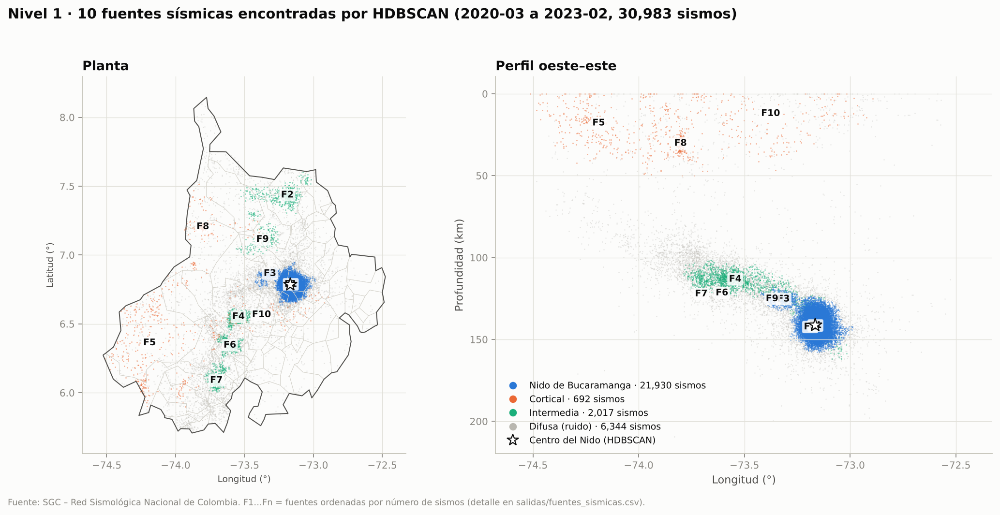
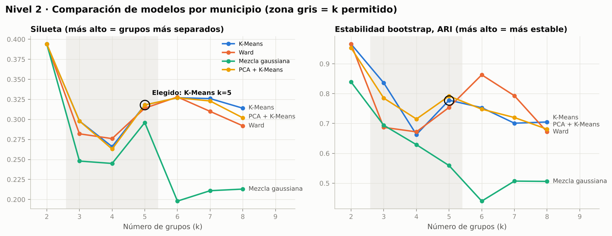
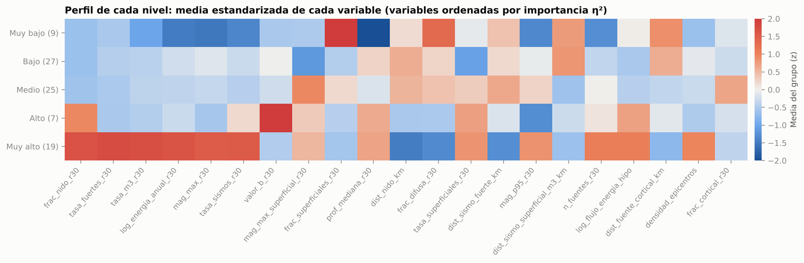
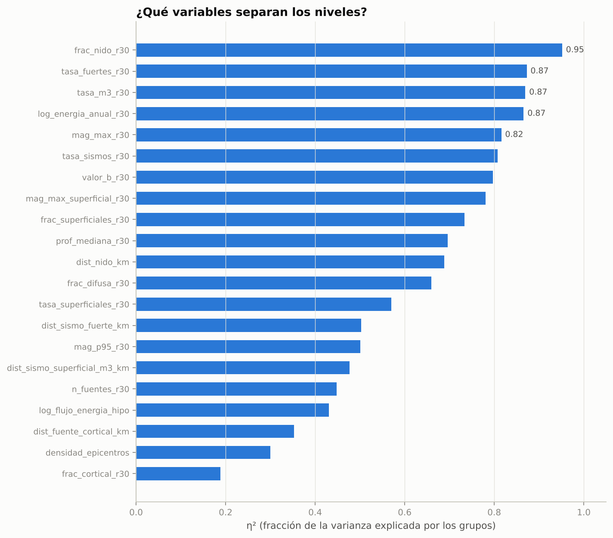
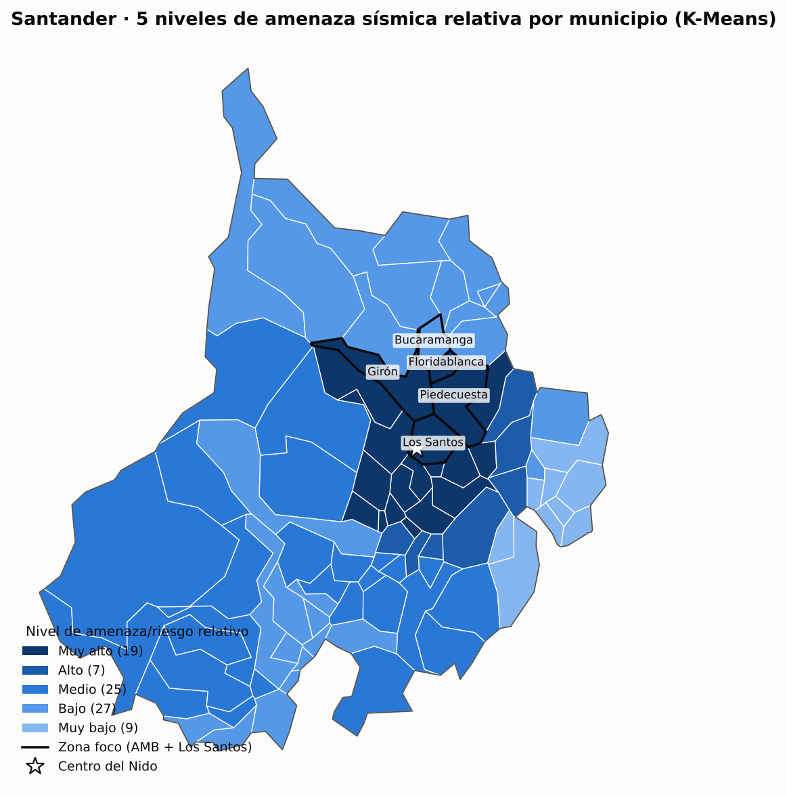
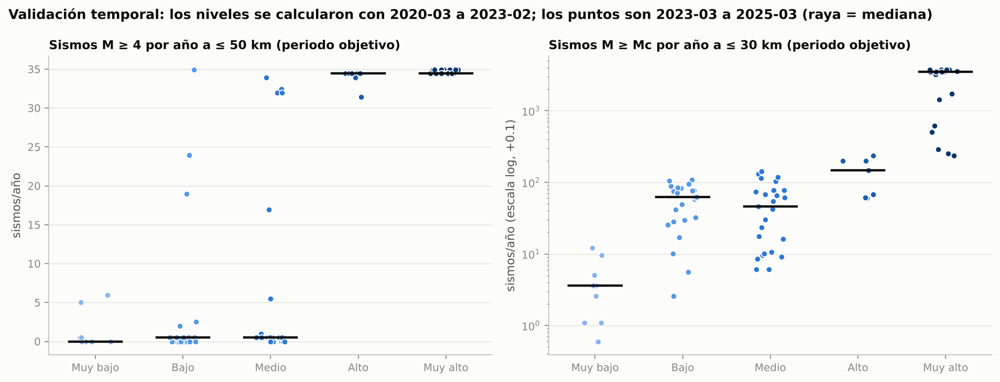

# Riesgo sísmico relativo de los 87 municipios de Santander

Reporte generado por `scripts/07_modelo_clustering.py` (`python run_all.py` lo regenera desde cero).

## 1. Resumen

- **Datos:** catálogo sísmico del SGC (RSNC), 2020-03-02 a 2025-03-01;
  completitud Mc = 2.0; sismos mal localizados excluidos.
- **Nivel 1 · HDBSCAN (una fila = un sismo):** 10 fuentes sísmicas en
  30,983 sismos; el Nido de Bucaramanga sale solo, centrado en 6.788, -73.166,
  141.3 km.
- **Nivel 2 · K-Means (una fila = un municipio):** 21 variables → **5 niveles** (silueta
  0.32, estabilidad bootstrap ARI 0.78 ± 0.14).
- **Validación temporal** (periodo objetivo 2023-03-01 a 2025-03-01, que
  no entró al modelo): Spearman nivel vs. sismos M ≥ 4 futuros = **0.70** (p = 7.9e-14);
  la tasa media futura crece en cada nivel.
- **Zona foco** (AMB + Los Santos): ver §7.

## 2. Datos y periodos

| | Desde | Hasta |
|---|---|---|
| Variables (entrada del modelo) | 2020-03-02 | 2023-02-28 |
| Objetivo (validación) | 2023-03-01 | 2025-03-01 |

Limpieza: `datos/interim/reporte_limpieza_sgc.md` · Variables: `datos/interim/reporte_variables.md` ·
Diccionario: `docs/diccionario_datos.md` · Origen: `docs/metadatos_origen.md`.

## 3. Nivel 1 · Fuentes sísmicas (HDBSCAN vs K-Means vs DBSCAN)

Entrada: x, y y profundidad de cada sismo, las tres en km. Silueta, Davies-Bouldin y Calinski-Harabasz sobre una
muestra de 6 000 sismos sin el ruido. `mezcla_profundidad` = fracción de sismos superficiales (< 30 km) mezclados
con intermedios (≥ 70 km) en el mismo grupo (0 = no los mezcla).

| metodo   |   n_fuentes |   pct_difusa |   silueta |   davies_bouldin |   calinski_harabasz |   mezcla_profundidad | parametros                                    |
|:---------|------------:|-------------:|----------:|-----------------:|--------------------:|---------------------:|:----------------------------------------------|
| HDBSCAN  |          10 |         20.5 |     0.588 |            0.586 |             5.7e+03 |                    0 | min_cluster_size=154, min_samples=10          |
| K-Means  |          10 |            0 |     0.339 |            0.904 |            5.39e+03 |                0.001 | k=10 (el mismo número de fuentes que HDBSCAN) |
| DBSCAN   |          18 |          4.3 |     0.471 |            0.485 |                 104 |                    0 | eps=8.4 km (codo k-distancia), min_samples=10 |

| codigo   | tipo                |   n_sismos |   prof_mediana_km |   prof_p10_km |   prof_p90_km |   mag_max |   n_m4 | municipio_cercano     |
|:---------|:--------------------|-----------:|------------------:|--------------:|--------------:|----------:|-------:|:----------------------|
| F1       | Nido de Bucaramanga |      21347 |             141.5 |         133.2 |         148.3 |       5.3 |    117 | Los Santos            |
| F2       | Intermedia          |        667 |             133.9 |         120.1 |           143 |       3.5 |      0 | El Playón             |
| F3       | Nido de Bucaramanga |        583 |             125.4 |         122.1 |         129.1 |       3.2 |      0 | Zapatoca              |
| F4       | Intermedia          |        551 |             113.3 |         108.4 |         118.5 |       3.7 |      0 | El Carmen de Chucuri  |
| F5       | Cortical            |        336 |              17.9 |           1.9 |            36 |       3.4 |      0 | Cimitarra             |
| F6       | Intermedia          |        303 |             113.1 |           106 |         118.9 |       3.6 |      0 | Santa Helena del Opón |
| F7       | Intermedia          |        296 |             113.7 |         109.3 |         118.1 |       3.8 |      0 | Chipatá               |
| F8       | Cortical            |        201 |              30.3 |          19.2 |          38.4 |       2.4 |      0 | Barrancabermeja       |
| F9       | Intermedia          |        200 |             116.7 |         108.7 |         124.5 |       2.9 |      0 | Girón                 |
| F10      | Cortical            |        155 |              12.1 |             0 |          29.7 |       3.6 |      0 | Hato                  |

## 4. Nivel 2 · Comparación de modelos por municipio

21 variables (log1p en las muy sesgadas y estandarización z). PCA conserva 7
componentes (90 % de la varianza). Mejor configuración de cada método:

| metodo           | parametro                                 |   n_grupos |   pct_sin_grupo |   tam_min |   silueta |   davies_bouldin |   calinski_harabasz |   ari_media |
|:-----------------|:------------------------------------------|-----------:|----------------:|----------:|----------:|-----------------:|--------------------:|------------:|
| HDBSCAN          | min_cluster_size=6                        |          3 |            36.8 |         8 |     0.447 |            0.726 |                51.9 |             |
| K-Means          | k=2                                       |          2 |               0 |        19 |     0.394 |            0.946 |                  53 |       0.966 |
| Ward             | k=2                                       |          2 |               0 |        19 |     0.394 |            0.946 |                  53 |       0.966 |
| PCA + K-Means    | k=2                                       |          2 |               0 |        19 |     0.394 |            0.946 |                  53 |       0.953 |
| Mezcla gaussiana | k=2                                       |          2 |               0 |        19 |     0.394 |            0.946 |                  53 |       0.839 |
| DBSCAN           | eps=2.22 (p50 4-distancia), min_samples=4 |          6 |            27.6 |         4 |     0.388 |            0.832 |                32.6 |             |

K-Means por número de grupos (estabilidad = ARI medio de 30 remuestreos bootstrap):

|   k |   silueta |   davies_bouldin |   calinski_harabasz |   tam_min |   ari_media |   ari_sd |
|----:|----------:|-----------------:|--------------------:|----------:|------------:|---------:|
|   2 |     0.394 |            0.946 |                  53 |        19 |       0.966 |    0.078 |
|   3 |     0.298 |             1.29 |                41.7 |        15 |       0.836 |    0.141 |
|   4 |     0.266 |              1.4 |                37.4 |        15 |       0.663 |     0.16 |
|   5 |     0.318 |              1.2 |                35.4 |         7 |       0.778 |    0.135 |
|   6 |     0.327 |             1.12 |                34.9 |         4 |       0.753 |    0.157 |
|   7 |     0.326 |             1.06 |                34.5 |         4 |       0.701 |    0.126 |
|   8 |     0.314 |             1.05 |                34.3 |         4 |       0.705 |    0.105 |

**Regla de selección:** K-Means, k entre 3 y 5 (interpretable), todos los grupos con
≥ 3 municipios y la mejor silueta → **k = 5**. La mejor silueta de todos los métodos que clasifican a todos los
municipios fue Ward (k=6, silueta 0.328). Se
prefiere K-Means porque clasifica a todos los municipios (DBSCAN/HDBSCAN dejan municipios sin grupo), sus
centroides son perfiles interpretables y es estable bajo remuestreo. Tabla completa: `comparacion_modelos.csv`.

## 5. Niveles de amenaza/riesgo relativo

Los grupos los forma K-Means; un índice solo los **nombra**: promedio de componentes estandarizados
(+ actividad, + magnitud, + energía, + superficialidad, − distancia a las fuentes), escalado 0–100.

| Nivel    |   Municipios |   Índice medio |   Sismos/año ≤30 km |   M≥4/año ≤30 km |   M máx |   Prof. mediana (km) |   Dist. Nido (km) | Ejemplos                                                                                                 |
|:---------|-------------:|---------------:|--------------------:|-----------------:|--------:|---------------------:|------------------:|:---------------------------------------------------------------------------------------------------------|
| Muy alto |           19 |           84.5 |              2036.3 |             27.2 |     5.1 |                140.9 |              24.2 | Los Santos, Zapatoca, Villanueva, Jordán, Barichara, San Gil                                             |
| Alto     |            7 |           40.4 |               126.3 |              0.0 |     3.4 |                138.7 |              39.1 | Socorro, Páramo, Valle de San José, Mogotes, San Andrés, Molagavita                                      |
| Medio    |           25 |           37.7 |                40.7 |              0.0 |     3.6 |                107.6 |              80.8 | El Carmen de Chucuri, Chima, Palmas del Socorro, San Vicente de Chucurí, Santa Helena del Opón, Confines |
| Bajo     |           27 |           26.2 |                43.4 |              0.2 |     3.8 |                124.0 |              81.5 | Bucaramanga, Tona, Lebrija, Charta, Matanza, California                                                  |
| Muy bajo |            9 |           19.2 |                 3.3 |              0.0 |     2.6 |                 26.3 |              61.1 | San Joaquín, San José de Miranda, Enciso, Capitanejo, Onzaga, San Miguel                                 |

Variables que más separan los niveles (η²): `frac_nido_r30` (0.95), `tasa_fuertes_r30` (0.87), `tasa_m3_r30` (0.87), `log_energia_anual_r30` (0.87), `mag_max_r30` (0.82).

**Municipios con perfil mixto** (su índice los ubicaría a 2 o más niveles de su grupo K-Means). K-Means agrupa por
el perfil completo de 21 variables, la mayoría medidas a ≤ 30 km; el índice pesa además
la sacudida con distancia hipocentral. Se reportan en vez de reasignarlos a mano:

| Municipio   | Nivel (K-Means)   | Nivel según índice   |   Índice |   Dist. Nido (km) |   Sismos/año ≤30 km |   log flujo energía |
|:------------|:------------------|:---------------------|---------:|------------------:|--------------------:|--------------------:|
| Bucaramanga | Bajo              | Alto                 |    56.70 |             42.09 |               53.08 |                1.86 |
| Charta      | Bajo              | Alto                 |    43.90 |             54.48 |               43.74 |                1.83 |
| Lebrija     | Bajo              | Alto                 |    44.00 |             54.30 |               71.11 |                1.84 |
| Tona        | Bajo              | Alto                 |    51.10 |             48.01 |               24.37 |                1.84 |
| Guaca       | Alto              | Bajo                 |    25.30 |             43.05 |               21.03 |                1.85 |
| Bolívar     | Medio             | Muy bajo             |    16.80 |            139.82 |                7.01 |                1.63 |
| La Belleza  | Medio             | Muy bajo             |    16.60 |            139.34 |               14.36 |                1.62 |
| Jesús María | Medio             | Muy bajo             |    18.80 |            128.82 |               43.40 |                1.65 |

## 6. Validación temporal (sin fuga de información)

La variable objetivo `obj_tasa_fuertes_futura_r50` (sismos M ≥ 4 por año a ≤ 50 km) se
calcula con un periodo **posterior** y distinto al de las variables, y no entra al modelo.

| nivel    |   municipios |   objetivo_media |   objetivo_mediana |   futura_r30_media |   futura_r30_mediana |
|:---------|-------------:|-----------------:|-------------------:|-------------------:|---------------------:|
| Muy bajo |            9 |             1.33 |               0.00 |               4.27 |                 3.49 |
| Bajo     |           27 |             3.25 |               0.50 |              56.85 |                61.87 |
| Medio    |           25 |             6.33 |               0.50 |              52.71 |                45.91 |
| Alto     |            7 |            33.93 |              34.43 |             138.86 |               147.20 |
| Muy alto |           19 |            34.64 |              34.43 |            2533.25 |              3512.29 |

- Spearman(nivel, objetivo) = **0.70** (p = 7.9e-14); Spearman(índice, objetivo) = 0.83 (p = 1.0e-23).
- Spearman(nivel, sismos M ≥ Mc futuros a ≤ 30 km) = 0.73 (p = 1.2e-15).
- Kruskal-Wallis entre niveles: H = 54.1, p = 5.0e-11.
- Referencia ingenua (persistencia: la tasa M ≥ 4 pasada predice la futura): Spearman = 0.69. El nivel resume
  21 variables y alcanza 0.70, es decir, los grupos anticipan dónde siguió la actividad fuerte.

## 7. Zona foco (AMB + Los Santos) vs resto de Santander

| Municipio     | Nivel    |   Índice |   tasa_sismos_r30 |   tasa_fuertes_r30 |   dist_nido_km |   obj_tasa_fuertes_futura_r50 |
|:--------------|:---------|---------:|------------------:|-------------------:|---------------:|------------------------------:|
| Los Santos    | Muy alto |    100.0 |            2983.4 |               41.7 |            6.4 |                          34.9 |
| Piedecuesta   | Muy alto |     81.2 |            2671.9 |               39.7 |           24.6 |                          34.9 |
| Girón         | Muy alto |     79.3 |             865.4 |               24.4 |           32.0 |                          34.9 |
| Floridablanca | Muy alto |     58.3 |             291.8 |                4.0 |           34.9 |                          34.9 |
| Bucaramanga   | Bajo     |     56.7 |              53.1 |                1.7 |           42.1 |                          34.9 |

Distribución por nivel:

| nivel    |   Resto |   Zona foco |
|:---------|--------:|------------:|
| Muy bajo |       9 |           0 |
| Bajo     |      26 |           1 |
| Medio    |      25 |           0 |
| Alto     |       7 |           0 |
| Muy alto |      15 |           4 |

Comparación de medias (prueba de Mann-Whitney):

| variable                    |   zona_foco_media |   resto_media |   razon |   p_mann_whitney |
|:----------------------------|------------------:|--------------:|--------:|-----------------:|
| tasa_sismos_r30             |          1.37e+03 |           426 |    3.22 |           0.0191 |
| tasa_m3_r30                 |               144 |          36.5 |    3.94 |          0.00532 |
| tasa_fuertes_r30            |              22.3 |          5.01 |    4.45 |         0.000326 |
| mag_max_r30                 |              5.02 |          3.81 |    1.32 |          0.00299 |
| log_energia_anual_r30       |              12.6 |          10.7 |    1.18 |          0.00155 |
| prof_mediana_r30            |               143 |           112 |    1.27 |          0.00695 |
| frac_superficiales_r30      |           0.00528 |         0.153 |  0.0346 |           0.0138 |
| tasa_superficiales_r30      |                 2 |          2.54 |    0.79 |            0.701 |
| dist_nido_km                |                28 |          65.4 |   0.428 |          0.00369 |
| frac_nido_r30               |             0.747 |         0.233 |    3.21 |          0.00175 |
| indice_riesgo               |              75.1 |          40.7 |    1.85 |          0.00497 |
| obj_tasa_fuertes_futura_r50 |              34.9 |          11.9 |    2.93 |         0.000279 |

## 8. Clasificación de los 87 municipios

| Municipio              | Nivel    |   Índice |   Sismos/año |   M≥4/año |   M máx |   Prof. (km) |   Dist. Nido (km) |   Objetivo (M≥4/año ≤50 km) |
|:-----------------------|:---------|---------:|-------------:|----------:|--------:|-------------:|------------------:|----------------------------:|
| Los Santos             | Muy alto |    100.0 |       2983.4 |      41.7 |     5.3 |        140.9 |               6.4 |                        34.9 |
| Zapatoca               | Muy alto |     98.0 |       2989.1 |      41.4 |     5.3 |        140.9 |              12.0 |                        34.9 |
| Villanueva             | Muy alto |     97.8 |       2973.7 |      40.7 |     5.3 |        140.9 |              13.5 |                        34.4 |
| Jordán                 | Muy alto |     96.5 |       2968.1 |      41.1 |     5.3 |        140.9 |              11.2 |                        34.9 |
| Barichara              | Muy alto |     96.0 |       2977.1 |      40.4 |     5.3 |        140.9 |              17.9 |                        34.9 |
| San Gil                | Muy alto |     95.8 |       2726.0 |      38.7 |     5.3 |        140.6 |              24.2 |                        34.4 |
| Galán                  | Muy alto |     93.4 |       2951.0 |      40.4 |     5.3 |        140.6 |              22.4 |                        34.9 |
| Cabrera                | Muy alto |     91.9 |       2838.2 |      40.1 |     5.3 |        140.6 |              23.5 |                        34.4 |
| Aratoca                | Muy alto |     88.4 |       2918.3 |      40.7 |     5.3 |        141.0 |              19.0 |                        34.4 |
| Curití                 | Muy alto |     85.6 |       2658.2 |      33.7 |     5.3 |        140.6 |              24.7 |                        34.4 |
| Palmar                 | Muy alto |     82.3 |       1209.6 |      11.7 |     5.2 |        137.3 |              31.1 |                        34.4 |
| Hato                   | Muy alto |     82.2 |        358.9 |       2.0 |     5.2 |        133.9 |              34.5 |                        34.4 |
| Piedecuesta            | Muy alto |     81.2 |       2671.9 |      39.7 |     5.3 |        141.6 |              24.6 |                        34.9 |
| Girón                  | Muy alto |     79.3 |        865.4 |      24.4 |     5.3 |        144.3 |              32.0 |                        34.9 |
| Betulia                | Muy alto |     75.6 |        276.8 |       7.3 |     5.1 |        142.2 |              35.4 |                        34.4 |
| Cepitá                 | Muy alto |     75.2 |       2422.2 |      23.0 |     5.1 |        140.7 |              26.9 |                        34.4 |
| Pinchote               | Muy alto |     71.6 |       1300.7 |       3.3 |     4.4 |        137.6 |              31.0 |                        34.4 |
| Floridablanca          | Muy alto |     58.3 |        291.8 |       4.0 |     4.6 |        146.1 |              34.9 |                        34.9 |
| Santa Bárbara          | Muy alto |     56.7 |        309.8 |       2.7 |     4.6 |        146.1 |              34.6 |                        34.4 |
| Socorro                | Alto     |     54.3 |        317.2 |       0.0 |     3.7 |        134.8 |              35.8 |                        34.4 |
| Páramo                 | Alto     |     48.1 |        100.8 |       0.0 |     3.5 |        133.5 |              39.2 |                        34.4 |
| Valle de San José      | Alto     |     44.8 |        128.9 |       0.0 |     3.4 |        134.4 |              39.0 |                        34.4 |
| Mogotes                | Alto     |     40.5 |        185.6 |       0.0 |     3.3 |        135.5 |              38.0 |                        34.4 |
| San Andrés             | Alto     |     37.4 |         73.1 |       0.0 |     3.4 |        144.3 |              38.6 |                        34.4 |
| Molagavita             | Alto     |     32.6 |         57.8 |       0.0 |     3.2 |        139.6 |              40.0 |                        33.9 |
| Guaca                  | Alto     |     25.3 |         21.0 |       0.0 |     3.4 |        148.5 |              43.0 |                        31.4 |
| El Carmen de Chucuri   | Medio    |     56.4 |         95.2 |       0.0 |     3.7 |        114.4 |              45.7 |                        32.4 |
| Chima                  | Medio    |     54.4 |        117.2 |       0.0 |     3.7 |        114.5 |              51.5 |                        17.0 |
| Palmas del Socorro     | Medio    |     53.8 |         56.8 |       0.0 |     3.7 |        118.6 |              46.9 |                        31.9 |
| San Vicente de Chucurí | Medio    |     51.3 |         75.5 |       0.3 |     4.3 |        123.6 |              42.9 |                        33.9 |
| Santa Helena del Opón  | Medio    |     50.6 |        122.9 |       0.0 |     3.7 |        113.5 |              60.3 |                         0.5 |
| Confines               | Medio    |     49.0 |         30.7 |       0.0 |     3.5 |        123.0 |              46.4 |                        31.9 |
| Guapotá                | Medio    |     45.7 |         51.7 |       0.0 |     3.5 |        118.0 |              54.9 |                         1.0 |
| Coromoro               | Medio    |     44.3 |          7.3 |       0.0 |     3.7 |         86.9 |              63.8 |                         0.5 |
| Encino                 | Medio    |     42.7 |          5.0 |       0.0 |     3.7 |        143.7 |              82.0 |                         0.5 |
| Ocamonte               | Medio    |     42.7 |         14.0 |       0.0 |     3.4 |        145.9 |              52.1 |                         5.5 |
| Charalá                | Medio    |     41.8 |         10.0 |       0.0 |     3.7 |        146.8 |              69.1 |                         0.5 |
| Contratación           | Medio    |     41.8 |         88.5 |       0.0 |     3.7 |        113.6 |              66.8 |                         0.5 |
| Cimitarra              | Medio    |     41.4 |          3.7 |       0.0 |     3.7 |         15.2 |             115.1 |                         0.0 |
| Oiba                   | Medio    |     38.9 |         18.7 |       0.0 |     3.5 |        122.4 |              63.8 |                         0.5 |
| Guadalupe              | Medio    |     37.1 |         46.7 |       0.0 |     3.5 |        115.7 |              64.7 |                         0.5 |
| Landázuri              | Medio    |     34.5 |         66.1 |       0.0 |     3.6 |        110.9 |              81.7 |                         0.0 |
| El Peñón               | Medio    |     31.6 |         41.4 |       0.0 |     3.8 |        109.7 |             113.3 |                         0.0 |
| Puerto Parra           | Medio    |     30.6 |          5.0 |       0.0 |     3.7 |         87.4 |              89.2 |                         0.0 |
| Barrancabermeja        | Medio    |     28.3 |          6.0 |       0.0 |     2.8 |         85.9 |              71.3 |                         0.5 |
| Gámbita                | Medio    |     25.9 |          4.0 |       0.0 |     3.7 |        142.9 |              93.8 |                         0.5 |
| Guavatá                | Medio    |     25.0 |         57.4 |       0.0 |     3.8 |        111.4 |             110.7 |                         0.0 |
| Sucre                  | Medio    |     23.1 |         29.4 |       0.0 |     3.4 |        104.0 |             125.6 |                         0.0 |
| Jesús María            | Medio    |     18.8 |         43.4 |       0.0 |     3.8 |        110.0 |             128.8 |                         0.0 |
| Bolívar                | Medio    |     16.8 |          7.0 |       0.0 |     3.4 |         16.5 |             139.8 |                         0.0 |
| La Belleza             | Medio    |     16.6 |         14.4 |       0.0 |     3.4 |         95.4 |             139.3 |                         0.0 |
| Bucaramanga            | Bajo     |     56.7 |         53.1 |       1.7 |     4.6 |        142.8 |              42.1 |                        34.9 |
| Tona                   | Bajo     |     51.1 |         24.4 |       1.0 |     4.6 |        153.3 |              48.0 |                        19.0 |
| Lebrija                | Bajo     |     44.0 |         71.1 |       0.3 |     4.2 |        133.9 |              54.3 |                         2.5 |
| Charta                 | Bajo     |     43.9 |         43.7 |       0.7 |     4.6 |        139.6 |              54.5 |                         2.0 |
| Matanza                | Bajo     |     38.2 |         65.8 |       0.3 |     4.2 |        137.4 |              66.2 |                         0.5 |
| California             | Bajo     |     34.8 |         25.7 |       0.3 |     4.2 |        147.5 |              65.1 |                         0.5 |
| Sabana de Torres       | Bajo     |     34.0 |          9.7 |       0.3 |     4.2 |         96.7 |              89.6 |                         0.0 |
| Vélez                  | Bajo     |     31.1 |         85.1 |       0.0 |     3.8 |        112.5 |              84.7 |                         0.0 |
| El Guacamayo           | Bajo     |     30.6 |         76.1 |       0.0 |     3.6 |        113.7 |              71.7 |                         0.5 |
| La Paz                 | Bajo     |     30.6 |         82.8 |       0.0 |     3.8 |        113.3 |              81.7 |                         0.5 |
| Rionegro               | Bajo     |     29.5 |         50.4 |       0.0 |     3.5 |        134.0 |              80.5 |                         0.5 |
| Simacota               | Bajo     |     28.7 |         22.0 |       0.0 |     3.4 |        104.2 |              70.3 |                         0.0 |
| El Playón              | Bajo     |     27.4 |         56.4 |       0.0 |     3.5 |        135.6 |              83.4 |                         0.0 |
| Vetas                  | Bajo     |     27.4 |         13.4 |       0.0 |     3.9 |        152.8 |              68.9 |                         0.5 |
| Aguada                 | Bajo     |     27.0 |         78.5 |       0.0 |     3.8 |        114.0 |              78.6 |                         0.5 |
| Suratá                 | Bajo     |     27.0 |         53.4 |       0.0 |     3.9 |        137.6 |              76.0 |                         0.5 |
| Málaga                 | Bajo     |     24.1 |         12.7 |       0.0 |     2.8 |        143.9 |              46.2 |                        24.0 |
| San Benito             | Bajo     |     22.5 |         65.1 |       0.0 |     3.8 |        114.3 |              86.9 |                         0.5 |
| Chipatá                | Bajo     |     20.0 |         61.4 |       0.0 |     3.8 |        112.8 |              96.0 |                         0.0 |
| Suaita                 | Bajo     |     19.5 |         14.0 |       0.0 |     3.3 |        119.3 |              77.7 |                         0.5 |
| Güepsa                 | Bajo     |     17.6 |         56.8 |       0.0 |     3.8 |        113.5 |              95.4 |                         0.0 |
| Barbosa                | Bajo     |     14.3 |         51.1 |       0.0 |     3.8 |        113.2 |             107.0 |                         0.0 |
| Puerto Wilches         | Bajo     |     11.2 |          5.0 |       0.0 |     3.8 |         85.4 |             119.5 |                         0.0 |
| Puente Nacional        | Bajo     |     10.2 |         44.1 |       0.0 |     3.8 |        111.7 |             121.5 |                         0.0 |
| Albania                | Bajo     |      5.7 |         31.4 |       0.0 |     3.5 |        108.3 |             132.2 |                         0.0 |
| Cerrito                | Bajo     |      0.2 |          2.0 |       0.0 |     2.1 |        154.3 |              58.9 |                         0.5 |
| Florián                | Bajo     |      0.0 |         17.7 |       0.0 |     3.3 |        103.6 |             144.4 |                         0.0 |
| San Joaquín            | Muy bajo |     31.1 |          8.0 |       0.0 |     2.9 |         69.1 |              51.0 |                         5.0 |
| San José de Miranda    | Muy bajo |     25.7 |          6.0 |       0.0 |     2.8 |         73.2 |              50.1 |                         6.0 |
| Enciso                 | Muy bajo |     23.5 |          4.0 |       0.0 |     2.8 |         14.7 |              55.7 |                         0.5 |
| Capitanejo             | Muy bajo |     23.3 |          3.7 |       0.0 |     2.8 |         12.9 |              59.5 |                         0.0 |
| Onzaga                 | Muy bajo |     21.6 |          1.7 |       0.0 |     2.7 |         14.1 |              64.6 |                         0.5 |
| San Miguel             | Muy bajo |     16.3 |          2.7 |       0.0 |     2.4 |         12.6 |              61.1 |                         0.0 |
| Carcasí                | Muy bajo |     11.3 |          2.0 |       0.0 |     2.4 |         14.7 |              67.0 |                         0.0 |
| Macaravita             | Muy bajo |     11.3 |          1.7 |       0.0 |     2.4 |         13.4 |              70.8 |                         0.0 |
| Concepción             | Muy bajo |      9.1 |          0.3 |       0.0 |     2.4 |         11.9 |              70.2 |                         0.0 |

Mapa interactivo: `salidas/mapa_riesgo_santander.html` (ábrelo en el navegador).

## 9. Alcance y limitaciones

- **Amenaza vs riesgo.** Riesgo = amenaza × exposición × vulnerabilidad. La vulnerabilidad (tipo de construcción)
  no está en estas fuentes: el resultado es un **riesgo relativo** entre municipios, no pérdidas absolutas.
- **Profundidad.** Los sismos del Nido (~140 km) se sienten mucho menos que uno cortical de igual magnitud; por eso
  hay variables de superficialidad y distancia a fuentes corticales, y el índice suma la superficialidad aparte.
- **Periodo corto.** Solo hay exports del SGC de 2020-03-02 a 2025-03-01: las variables usan 2020-03-02 a 2023-02-28 y el objetivo 2023-03-01 a 2025-03-01. Con los exports 2006–2025 el pipeline vuelve solo a 2006–2020 / 2021–2025 (`config.py`).
- **Consulta por departamento.** Los exports se pidieron con filtro *departamento = Santander*, así que faltan los sismos que caen justo fuera del límite; los municipios de borde quedan algo subestimados. La consulta por cuadrante (README §2.1) lo corrige.
- **Sin sismicidad histórica.** Falta `datos/raw/sgc_historico/`; las 3 variables históricas no entraron.
- **Sin población.** Falta la población DANE; el resultado es amenaza relativa sin exposición.
